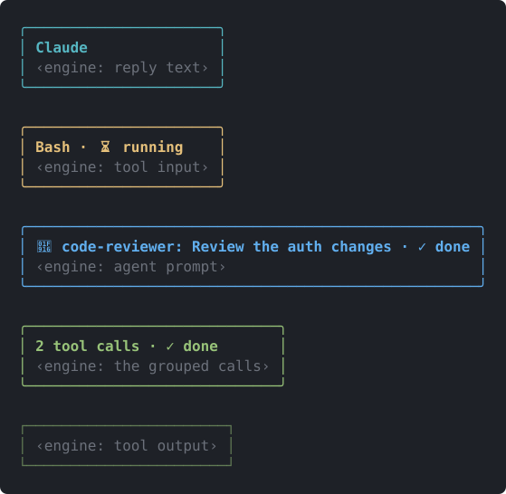
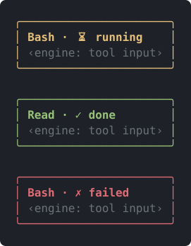
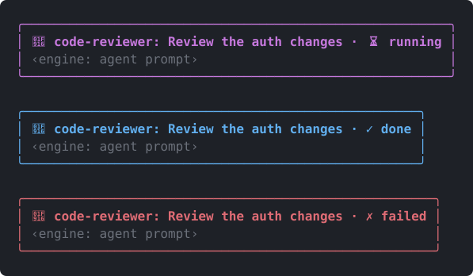
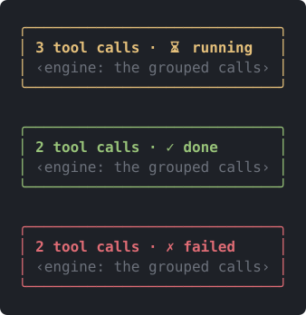
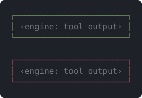
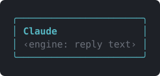

<div align="center">

<a href="README.md"></a>&nbsp;&nbsp;<a href="README.tr.md"></a>

# terminal-gui

**Turns Claude Code terminal output into GUI-like cards.**



</div>

## What it does

- **Tool rows** become cards: yellow `⏳ running` while active, green `✓ done` when finished, red `✗ failed` on error. An interrupted call also shows as `✗ failed`.
- **Subagent rows** (the `Agent` tool, formerly `Task`): magenta while running, blue when done, red on error. The header reads `🤖 <subagent_type>: <description>`.
- **ToolGroup** card: `N tool calls · <status>`.
- **ToolResult** gets a thin green border (red on error).
- **Assistant replies** appear in a cyan, rounded "Claude" bubble. The title shows only on the first block of a reply.

It only affects the terminal surface. The expanded view (`ctrl+o` / `--verbose`) keeps the default drawing for tool rows, results and groups, and so do other surfaces.

## Install

Needs Claude Code v2.1.287 or later.

```bash
claude plugin marketplace add diyojenyazilim/claude-plugins
claude plugin install terminal-gui@diyojenyazilim
```

Or inside a session:

```text
/plugin marketplace add diyojenyazilim/claude-plugins
/plugin install terminal-gui@diyojenyazilim
```

If a session is already open, run `/reload-plugins` or start a new one.

## Update

```bash
claude plugin marketplace update diyojenyazilim
claude plugin update terminal-gui@diyojenyazilim
```

Restart Claude Code, or run `/reload-plugins` in an open session.

## Screenshots

<div align="center">
  
  <p>Tool card: running (yellow), done (green), failed (red).</p>
  
  <p>Subagent row: running (magenta), done (blue), failed (red).</p>
  
  <p>ToolGroup card: running, done, failed.</p>
  
  <p>ToolResult border: success (green), error (red).</p>
  
  <p>Assistant reply: cyan rounded "Claude" bubble.</p>
</div>

> These images are not captures of a live session. They are SVGs drawn by a script from the element tree (Box/Text, colors, borders) that the mod's `ui.render` hooks produce under `claude plugin test`. Lines in `‹engine: …›` brackets stand in for Claude Code's own content (tool input/output, reply text). Your terminal's font, color theme and emoji width may look different.

## Local development

```bash
git clone https://github.com/diyojenyazilim/terminal-gui.git
claude --plugin-dir ./terminal-gui
```

After editing, run `/reload-plugins` or open a new session. Checks, run from the repository root:

```bash
claude plugin validate .
claude plugin test .
```

## File layout

```text
terminal-gui/
├── .claude-plugin/plugin.json   plugin manifest
├── hooks/
│   ├── hooks.json               declares the module (./register.tsx)
│   ├── register.tsx             ui.render registrations
│   └── register.test.tsx        tests
├── assets/                      README images
├── LICENSE
├── README.md
└── README.tr.md
```

## Security

> [!WARNING]
> Mods run outside a sandbox, with your user's permissions. Read `hooks/register.tsx` before installing.

## License

MIT, see [LICENSE](LICENSE).
