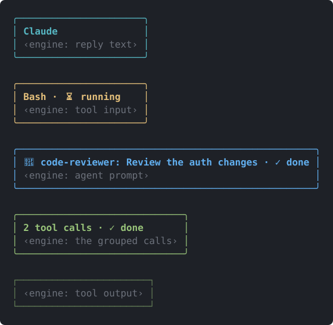
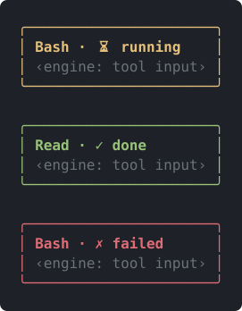
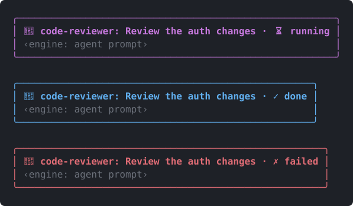
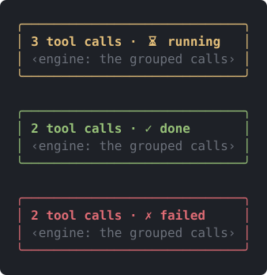
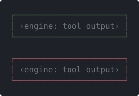
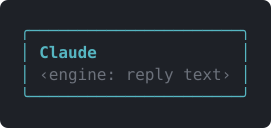

<div align="center">

<a href="README.md"></a>&nbsp;&nbsp;<a href="README.tr.md"></a>

# terminal-gui

**Claude Code terminal çıktısını GUI benzeri kartlara dönüştürür.**



</div>

## Ne yapar

- **Araç satırları** kart olur: çalışırken sarı `⏳ running`, bitince yeşil `✓ done`, hatada kırmızı `✗ failed`. Yarıda kesilen çağrı da `✗ failed` görünür.
- **Alt ajan satırları** (`Agent` aracı, eski adıyla `Task`): çalışırken macenta, bitince mavi, hatada kırmızı. Başlık `🤖 <subagent_type>: <description>`.
- **ToolGroup** kartı: `N tool calls · <durum>`.
- **ToolResult** ince yeşil (hata ise kırmızı) çerçeve alır.
- **Asistan yanıtları** cyan, yuvarlak köşeli "Claude" balonunda gösterilir. Başlık yalnız yanıtın ilk bloğunda çıkar.
- **Senin mesajların** macenta, yuvarlak köşeli "You" balonunda gösterilir. Görev bildirimleri ve diğer ajanlardan gelen mesajlar varsayılan satırda kalır.
- **Spinner** (`Beaming… (1m 1s · …)`) o anki aşamanın simgesini alır: 📡 istek, 🧠 düşünüyor, ✍️ yanıt yazıyor, ⌨️ araç girdisi, 🔧 araç çalışıyor. Yalnız kelime değişir; süre ve token sayısı korunur.
- **Slash komut çıktısı** (`/cost`, `/context` …) mavi `/komut` kartı olur (hatada kırmızı).
- **Tur sonu satırı** yeşil `✓ Baked for 1m 4s` olarak gösterilir. "Arka plan ajanlarını bekliyor" hâli varsayılan metni korur.
- **Arka planda çalıştır ipucu** (`ctrl+b`) aracın altında sarı `↳` satırı olarak çizilir.

Spinner altındaki `Tip: …` satırı eklentilerce şekillendirilemez; istemiyorsan `/config` içindeki `tips` satırından kapat.

Yalnızca terminal yüzeyini etkiler. Genişletilmiş görünüm (`ctrl+o` / `--verbose`) araç satırları, sonuçlar ve gruplar için varsayılan çizimi korur; diğer yüzeyler de öyle.

## Kurulum

Claude Code v2.1.287 veya üstü gerekir.

```bash
claude plugin marketplace add diyojenyazilim/claude-plugins
claude plugin install terminal-gui@diyojenyazilim
```

Ya da bir oturumun içinden:

```text
/plugin marketplace add diyojenyazilim/claude-plugins
/plugin install terminal-gui@diyojenyazilim
```

Oturum zaten açıksa `/reload-plugins` çalıştır veya yeni bir oturum başlat.

## Güncelleme

```bash
claude plugin marketplace update diyojenyazilim
claude plugin update terminal-gui@diyojenyazilim
```

Claude Code'u yeniden başlat ya da açık oturumda `/reload-plugins` çalıştır.

## Ekran görüntüleri

<div align="center">
  
  <p>Araç kartı: çalışıyor (sarı), bitti (yeşil), hata (kırmızı).</p>
  
  <p>Alt ajan satırı: çalışıyor (macenta), bitti (mavi), hata (kırmızı).</p>
  
  <p>ToolGroup kartı: çalışıyor, bitti, hata.</p>
  
  <p>ToolResult çerçevesi: başarılı (yeşil), hatalı (kırmızı).</p>
  
  <p>Asistan yanıtı: cyan yuvarlak köşeli "Claude" balonu.</p>
</div>

> Bu görseller canlı bir oturumun ekran görüntüsü değildir. `claude plugin test` ortamında modun `ui.render` kancalarının ürettiği öğe ağacından (Box/Text, renk, kenarlık) bir betikle SVG olarak çizilmiştir. Köşeli parantezli `‹engine: …›` satırları, Claude Code'un kendi içeriğinin (araç girdisi/çıktısı, yanıt metni) yerini tutar. Gerçek terminal yazı tipi, renk teması ve emoji genişliği farklı olabilir.

## Yerel geliştirme

```bash
git clone https://github.com/diyojenyazilim/terminal-gui.git
claude --plugin-dir ./terminal-gui
```

Düzenlemeden sonra `/reload-plugins` çalıştır veya yeni oturum aç. Kontroller, depo kökünden:

```bash
claude plugin validate .
claude plugin test .
```

## Dosya yapısı

```text
terminal-gui/
├── .claude-plugin/plugin.json   eklenti manifesti
├── hooks/
│   ├── hooks.json               modülü bildirir (./register.tsx)
│   ├── register.tsx             ui.render kayıtları
│   └── register.test.tsx        testler
├── assets/                      README görselleri
├── LICENSE
├── README.md
└── README.tr.md
```

## Güvenlik

> [!WARNING]
> Modlar sandbox dışında, kullanıcı yetkileriyle çalışır. Kurmadan önce `hooks/register.tsx` kaynağını oku.

## Lisans

MIT, bkz. [LICENSE](LICENSE).
